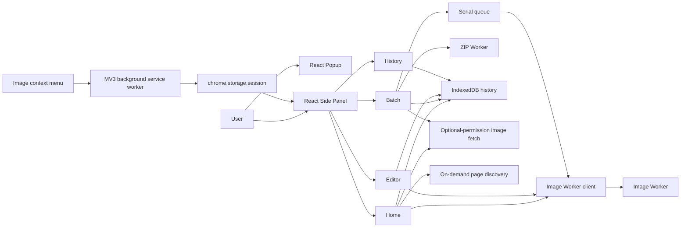

# Architecture

The diagram describes source connections, not an end-to-end browser verification.

## Runtime contexts

- `entrypoints/popup`: React popup for opening the workspace.
- `entrypoints/sidepanel`: React image workspace.
- `entrypoints/background.ts`: Manifest V3 service worker registering image menus and handing selected image metadata to the Side Panel.
- `src/content/image-discovery.ts`: self-contained page function executed through `chrome.scripting` after an explicit user action.
- `src/engine`: signature detection, resize/crop validation, image processing, native browser adapter, and short-lived worker client/entrypoint. One engine options contract handles format conversion, resize, crop, rotation, and flips.
- `src/tasks`: serial batch queue, shared-setting batch presets, and ZIP generation in a dedicated Worker.
- `src/storage`: bounded IndexedDB history for completed output Blobs and task metadata.
- `src/browser`: explicit-origin optional permission, and bounded remote-image fetch.

## Image processing

1. Local input or a permitted remote image is checked by signature and size.
2. A short-lived module Worker decodes with `ImageBitmap`, validates dimensions, renders with `OffscreenCanvas`, and verifies the actual encoded MIME type.
3. Decoded bitmaps are closed in `finally`; callers abort/terminate workers on cancellation or component cleanup.
4. The batch queue executes one image at a time; input, output and pixel limits bound resource use. List previews are lazy-loaded and displayed totals are reduced from actual task results.
5. ZIP generation runs in a separate cancellable Worker. Queue processing and image import are held while ZIP generation is active to avoid overlapping heavy work. Individual results use Blob URLs and object URLs are revoked when tasks are deleted/unmounted or after downloads.

## Persistence

The IndexedDB database stores completed output Blobs and metadata on the current browser profile, including the operation type. Retention is bounded to 100 records and 500 MB of outputs; the oldest entries are evicted first. History metadata is read using a cursor without retaining every output Blob in React state; summaries include the exact stored Blob byte size, and a single output Blob is loaded on demand for download. History can be searched by filename, filtered by operation/status, and sorted by date. A row only exposes download when a persisted output Blob exists.

## Browser handoff and permission

Context-menu actions validate HTTP(S) sources and pass the URL/action through `chrome.storage.session`. Remote fetch begins only after an explicit user click and a request for the exact origin's optional host permission. Fetches omit cookies and referrers, reject redirects, accept selected image MIME types, and enforce a streamed 100 MB body limit. DNS rebinding cannot be reliably prevented by hostname checks and remains a documented limitation.

## UI and support boundaries

Popup and Side Panel share CSS tokens and respect `prefers-color-scheme`. The interface is currently English-only; runtime English/Simplified Chinese localization remains work for a future release. AVIF output is enabled only when the browser returns the requested MIME type.

The Side Panel navigation groups Workspace (Home, Batch), Tools (Convert, Compress, Resize, Editor), Library (History), and Preferences (Settings). Navigation labels are shown in the expanded rail and the rail can collapse to icons; very narrow panels use the compact icon rail. Convert, Compress, and Resize select modes in the same mounted Home view so the source image and result state remain available. Home handles one image at a time and directs multiple dropped images to Batch. Batch presets only configure the existing output format, quality, and resize controls; users can edit those values and the UI then marks the selection Custom. The Editor uses a source-pixel SVG overlay for drag crop, keeps numeric crop fields, and maintains a bounded undo/redo state for crop/rotate/flip edits; the shared image Worker still performs all pixel transforms. Watermark, tonal adjustments, and editor presets are labeled Planned and have no active controls.

## Known technical limits

- A 100-megapixel RGBA canvas is about 400 MiB before decoder, input, preview, output, or browser overhead. Batch retains original files and completed output Blobs; ZIP generation also materializes the final archive Blob. The byte limits do not guarantee low peak memory.
- Image and ZIP Workers can be cancelled and are terminated on completion/error, but they have no watchdog timeout if a browser operation stalls. The queue intentionally reports task states, not estimated percentage progress.
- The context-menu handoff uses session storage; an unused pending action has no expiry check. Remote-host validation cannot reliably prevent DNS rebinding; see [SECURITY.md](./SECURITY.md).
- IndexedDB retention is bounded by records and output bytes, but a browser's actual storage quota may be lower. There is no quota recovery UI.

The current implementation status and release boundary are tracked in [CURRENT_STATUS.md](./CURRENT_STATUS.md). Automated and manual verification boundaries are tracked in [TESTING.md](./TESTING.md).
